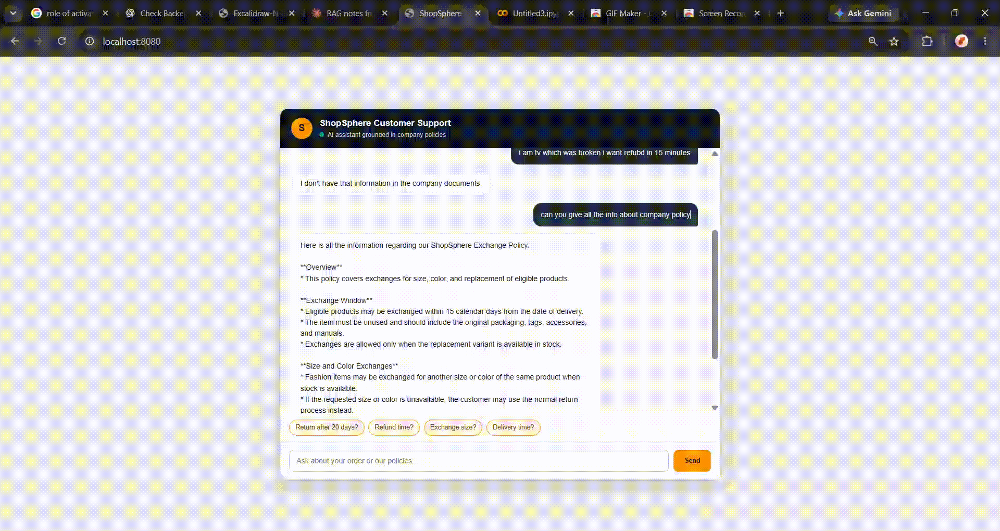
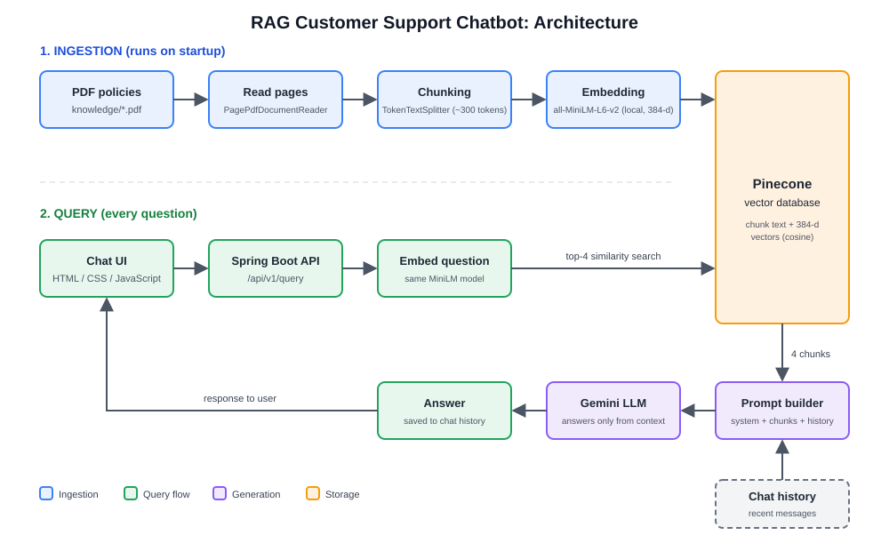

# RAG Customer Support Chatbot

An AI support assistant that answers customer questions using only a company's
policy documents (returns, refunds, exchanges, shipping, payments).

## How it works
1. **Ingestion:** PDFs → split into ~300-token chunks → embedded locally
   (all-MiniLM-L6-v2, 384-dim) → stored in Pinecone
2. **Query:** question → embedding → top-4 similar chunks from Pinecone
3. **Generation:** chunks + conversation history → Gemini → grounded answer
4. If the answer isn't in the documents, the bot says so instead of guessing

## Tech stack
Java 17, Spring Boot, Spring AI, Pinecone, Google Gemini,
HTML/CSS/JavaScript

## Run locally
1. Create a Pinecone index with **384 dimensions** and cosine metric
2. Set environment variables: `GEMINI_API_KEY`, `PINECONE_API_KEY`
3. Put your PDFs in `src/main/resources/knowledge/`
4. `mvn spring-boot:run`
5. Open http://localhost:8080

## Example questions
- "Can I return a product after 20 days?"
- "How long does a refund take?"

## Results
Tested on 50 questions: 87% answered correctly. Average response time 5.4s.

## Limitations & next steps
- Conversation history is in-memory (single user)
- Add per-session history, citations, and order-lookup via tool calling
- Dockerize and deploy